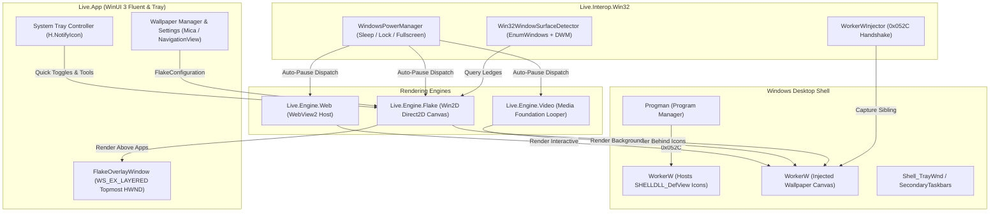

# Lively Wallpaper Windows (with Native Flake Mode)

> A modern, hardware-accelerated Live Wallpaper engine and ambient snowfall simulation for Windows 11 and Windows 10, built on **.NET 8.0, C# 12, WinUI 3 (Windows App SDK unpackaged), Win2D (Direct2D/DirectX), and CsWin32**.

---

## 1. Architecture Overview & High-Level Design

Lively Wallpaper Windows operates as an accessory desktop experience with two complementary presentation modes:
1. **Desktop Ambient Mode**: Injected directly behind Windows desktop icons (`SHELLDLL_DefView`) via the Windows Shell `Progman` `0x052C` handshake. Supports hardware-accelerated looping video (Windows Media Foundation), interactive HTML5/WebGL (WebView2), and ambient desktop particle snowfall.
2. **Screen Overlay Mode**: A virtual-desktop-spanning, borderless, transparent, topmost window (`WS_EX_TOPMOST | WS_EX_LAYERED | WS_EX_TRANSPARENT | WS_EX_NOACTIVATE`) that simulates falling snow settling realistically on application window borders, the Windows Taskbar, and display shelves.



---

## 2. Technology Stack & Rationale

| Layer | Selected Technology | Technical Rationale |
|---|---|---|
| **Runtime & Language** | .NET 8.0 LTS + C# 12 | High-performance JIT/AOT, pattern matching, records, primary constructors, strong cross-platform symmetry with Swift 6. |
| **Application UI** | WinUI 3 (Windows App SDK 1.5+) Unpackaged | Windows 11 Fluent Design (Mica, Acrylic, PerMonitorV2 DPI). Running unpackaged (`<WindowsPackageType>None</WindowsPackageType>`) grants full standard Win32 P/Invoke access without MSIX virtualization restrictions. |
| **Particle & Snow Rendering** | Win2D (`Microsoft.Graphics.Win2D`) | Direct2D / Direct3D 11 immediate-mode rendering in C#. Delivers 60 FPS hardware-accelerated particle dynamics, sprite batching, and glow effects at < 1.0% CPU and < 1.5% GPU. |
| **Win32 & DWM Interop** | Microsoft CsWin32 Source Generator | Source-generated, type-safe, zero-allocation P/Invoke bindings for Win32, DWM, and Shell APIs compiled directly into the binary. |
| **Web Wallpaper Host** | Microsoft WebView2 (`Microsoft.Web.WebView2`) | Chromium-based HTML5, CSS3, WebGL, and WebGPU canvas wallpaper rendering with low memory overhead. |
| **System Tray Companion** | `H.NotifyIcon.WinUI` | Modern system tray integration with context menus, tooltips, and click routing. |
| **MVVM Architecture** | CommunityToolkit.Mvvm | ObservableProperty, RelayCommand, and WeakReferenceMessenger. |
| **Test Harness** | xUnit + FluentAssertions + Moq | Fast, deterministic unit and math testing on both Windows and cross-platform CI. |

---

## 3. Subsystem Architecture & Code Layout

```
Live_Windows/
├── Live_Windows.sln                  # Master Visual Studio 2022 / dotnet Solution
├── Directory.Build.props             # Global .NET 8, C# 12, Nullable, Platform configs
├── README.md                         # Architecture blueprint and developer guide
├── src/
│   ├── Live.Core/                    # Core domain models, Lively schema parser, interfaces
│   │   ├── Live.Core.csproj
│   │   ├── Models/
│   │   │   ├── WallpaperItem.cs      # Core wallpaper metadata (parity with macOS)
│   │   │   ├── WallpaperType.cs      # Video, Web, Url
│   │   │   ├── LivelyInfo.cs         # Lively JSON schema parser
│   │   │   └── AppState.cs           # Observable application state
│   │   ├── Flake/
│   │   │   ├── FlakeConfiguration.cs # Snowfall parameters, tools, plow settings
│   │   │   ├── CollisionSurface.cs   # Ledge geometry (Frame, TopEdgeY, MinX, MaxX)
│   │   │   └── WindVector.cs         # 360° trigonometric wind physics
│   │   ├── Interfaces/
│   │   │   ├── IWallpaperEngine.cs   # Playback engine lifecycle contract
│   │   │   ├── IDesktopWindowManager.cs # Desktop window lifecycle
│   │   │   ├── IPowerManager.cs      # Additive auto-pause power manager contract
│   │   │   └── IWindowSurfaceDetector.cs # Window ledge detector contract
│   │   └── Power/
│   │       ├── PauseReasons.cs       # Additive flags enum
│   │       └── PowerSettings.cs      # Power preferences
│   │
│   ├── Live.Interop.Win32/           # Win32, DWM, Shell, and Desktop injection interop
│   │   ├── Live.Interop.Win32.csproj
│   │   ├── NativeMethods.txt         # CsWin32 function inclusion list
│   │   ├── WorkerWInjector.cs        # Progman 0x052C handshake & desktop reparenting
│   │   ├── Win32WindowSurfaceDetector.cs # EnumWindows + DWM extended frame bounds detector
│   │   ├── WindowsPowerManager.cs    # Sleep, lock, battery, and fullscreen observer
│   │   └── MonitorEnumerator.cs      # Multi-monitor bounds and work areas
│   │
│   ├── Live.Engine.Flake/            # Win2D DirectX snow simulation engine
│   │   ├── Live.Engine.Flake.csproj
│   │   ├── FlakeEngine.cs            # Simulation controller & timer
│   │   ├── FlakeOverlayWindow.cs     # Borderless WS_EX_TRANSPARENT overlay HWND
│   │   ├── SnowParticleEmitter.cs    # Particle pool, physics, 360° wind forces
│   │   ├── SnowAccumulator.cs        # 10px-bin heightmaps & angle-of-repose diffusion
│   │   ├── SnowplowAnimator.cs       # Display bottom snowplow sweeps
│   │   └── FairyLightsRenderer.cs    # Window top garland glow renderer
│   │
│   ├── Live.Engine.Video/            # Media Foundation video looper
│   │   ├── Live.Engine.Video.csproj
│   │   └── VideoWallpaperEngine.cs   # Seamless video wallpaper playback
│   │
│   ├── Live.Engine.Web/              # WebView2 HTML5/WebGL wallpaper host
│   │   ├── Live.Engine.Web.csproj
│   │   └── WebWallpaperEngine.cs     # Chromium-based interactive wallpaper host
│   │
│   └── Live.App/                     # WinUI 3 desktop application & system tray
│       ├── Live.App.csproj
│       ├── app.manifest              # PerMonitorV2 DPI awareness & OS compatibility
│       ├── App.xaml / App.xaml.cs    # Application entry point & theme resources
│       ├── MainWindow.xaml / .cs     # Fluent Wallpaper Manager (NavigationView)
│       ├── Views/
│       │   ├── GalleryPage.xaml      # Wallpaper library grid
│       │   ├── FlakeSettingsPage.xaml# Flake controls (intensity, plow, tools)
│       │   ├── WindCompassControl.xaml # 360° interactive wind compass
│       │   └── SettingsPage.xaml     # General & auto-pause settings
│       ├── ViewModels/
│       │   ├── MainViewModel.cs      # Gallery and active wallpaper state
│       │   └── FlakeSettingsViewModel.cs # Flake configuration & tool routing
│       └── Tray/
│           └── TrayIconController.cs # System tray companion icon & popover menu
│
└── tests/
    ├── Live.Core.Tests/              # Unit tests for models, math, and serialization
    │   ├── Live.Core.Tests.csproj
    │   ├── FlakeConfigurationTests.cs
    │   ├── SnowAccumulatorTests.cs
    │   └── PauseReasonsTests.cs
    │
    └── Live.Interop.Tests/           # Mocks and geometry tests for window detection
        ├── Live.Interop.Tests.csproj
        └── WindowSurfaceDetectorTests.cs
```

---

## 4. Key Subsystem Implementations

### 4.1 Desktop Window Injection (`WorkerWInjector.cs`)
To place content behind desktop icons without obscuring desktop shortcuts:
1. Locate `Progman` via `FindWindow("Progman", null)`.
2. Dispatch message `0x052C` (`WM_SPAWN_WORKER`) with flags `0x0000000D, 0x00000001` via `SendMessageTimeout`. This instructs Windows Explorer to spawn a secondary `WorkerW` behind the icon host window (`SHELLDLL_DefView`).
3. Enumerate top-level windows using `EnumWindows`. Locate the `WorkerW` containing `SHELLDLL_DefView`. Its immediately succeeding sibling `WorkerW` is the wallpaper canvas.
4. Reparent the rendering window using `SetParent(renderHwnd, workerwHwnd)`.
5. Recover from `explorer.exe` restarts by listening for the registered window message `RegisterWindowMessage("TaskbarCreated")`.

### 4.2 Transparent Overlay Window (`FlakeOverlayWindow.cs`)
In Screen Overlay Mode, snowfall and drifts float above active application windows:
- **Window Styles**: `WS_POPUP | WS_VISIBLE`
- **Extended Styles**: `WS_EX_TOPMOST | WS_EX_TOOLWINDOW | WS_EX_LAYERED | WS_EX_TRANSPARENT | WS_EX_NOACTIVATE`
- **Virtual Bounds**: Spans all monitors using `GetSystemMetrics(SM_XVIRTUALSCREEN)`, `SM_YVIRTUALSCREEN`, `SM_CXVIRTUALSCREEN`, `SM_CYVIRTUALSCREEN`.
- **Dual-Gate Passthrough**:
  - When idle: `WS_EX_TRANSPARENT` is active. Clicks pass through to background apps with zero lag.
  - When interactive tool (Mitten/Shovel) is activated: `WS_EX_TRANSPARENT` is temporarily stripped while `WS_EX_NOACTIVATE` remains active. Dragging tools captures mouse coordinates to clear snow without stealing keyboard focus from active apps.

### 4.3 Window Surface & Ledge Detection (`Win32WindowSurfaceDetector.cs`)
- **Query Pipeline**: Enumerate windows top-to-bottom in Z-order using `EnumWindows`.
- **Filtering Rules**:
  - `IsWindowVisible(hwnd) == true` and `!IsIconic(hwnd)` (exclude minimized windows).
  - Exclude cloaked / virtual desktop windows using `DwmGetWindowAttribute(hwnd, DWMWA_CLOAKED)`.
  - Exclude small windows: `Width >= 120 && Height >= 80`.
  - Exclude system desktop windows (`Progman`, `WorkerW`, self HWND).
- **Physical Bounds**: Retrieve accurate physical borders without drop shadows using `DwmGetWindowAttribute(hwnd, DWMWA_EXTENDED_FRAME_BOUNDS)`.
- **Taskbar Detection**: Identify `Shell_TrayWnd` and `Shell_SecondaryTrayWnd` as `CollisionSurface` with `IsTaskbar = true`.
- **Occlusion Interval Clipping**: Track covered X-intervals of higher Z-order windows. Lower window top edges are clipped to only include exposed segments.

### 4.4 Particle Simulation & Heightmap Physics (`Live.Engine.Flake`)
- **Particle Dynamics**: Pre-allocated pool of up to 1,000 particles updated at 60 Hz. Trigonometric wind acceleration:
  $$\vec{a}_{wind} = (v_{wind} \cdot \cos\theta, v_{wind} \cdot \sin\theta)$$
- **Ledge Heightmaps**: Collision ledges are discretized into 10-pixel bins ($width / 10$).
- **Angle of Repose Smoothing**: Snowbank heights are diffused each frame using a 3-point convolution kernel:
  $$h_{smooth}[i] = \frac{h[i-1] + 2 \cdot h[i] + h[i+1]}{4}$$
- **Window Movement Tracking**: Surface detection runs at 10 Hz. When a window moves by $(\Delta x, \Delta y)$, its heightmap bins translate with it. When a window moves faster than $50\text{ px/frame}$ or is closed, the accumulated snowbank detaches and tumbles downward.
- **Automated Snowplow Sweeps**: When the bottom display snowbank exceeds $35\text{ px}$, a snowplow traverses the bottom ledge, flinging particle puffs and resetting bins.
- **Decorative Fairy Lights**: Strung along top window ledges with oscillating sine-wave twinkle intensities.

### 4.5 Additive Power Management (`WindowsPowerManager.cs`)
Cross-platform parity with macOS `PauseReasons` via an additive flags enum:
```csharp
[Flags]
public enum PauseReasons : int
{
    None            = 0,
    UserPaused      = 1 << 0,
    FullscreenApp   = 1 << 1,
    DisplaySleeping = 1 << 2,
    ScreenLocked    = 1 << 3,
    BatterySaver    = 1 << 4,
    All             = UserPaused | FullscreenApp | DisplaySleeping | ScreenLocked | BatterySaver
}
```
- Fullscreen app detection: checks foreground HWND bounds against monitor bounds.
- Display sleep: registers for `GUID_CONSOLE_DISPLAY_STATE` via `RegisterPowerSettingNotification`.
- Workstation lock: registers for session changes via `WTSRegisterSessionNotification`.
- Battery saver: queries `GetSystemPowerStatus`.

---

## 5. Cross-Platform Parity Mapping

| macOS Implementation (`Live_Mac`) | Windows Implementation (`Live_Windows`) | Role / Responsibility |
|---|---|---|
| `WallpaperItem.swift` | `Live.Core.Models.WallpaperItem.cs` | Wallpaper metadata & settings |
| `FlakeConfiguration.swift` | `Live.Core.Flake.FlakeConfiguration.cs` | Flake simulation parameters & tool modes |
| `CollisionSurface.swift` | `Live.Core.Flake.CollisionSurface.cs` | Ledge geometry & coordinates |
| `WindowSurfaceDetector.swift` | `Live.Interop.Win32.Win32WindowSurfaceDetector.cs` | Zero-privilege window ledge querying |
| `FlakeOverlayWindow.swift` | `Live.Engine.Flake.FlakeOverlayWindow.cs` | Topmost transparent click-through window |
| `FlakeScene.swift` | `Live.Engine.Flake.FlakeEngine.cs` | 60 Hz GPU particle render loop |
| `SnowAccumulator.swift` | `Live.Engine.Flake.SnowAccumulator.cs` | 10px-bin heightmaps & angle-of-repose math |
| `PowerManager.swift` | `Live.Interop.Win32.WindowsPowerManager.cs` | Sleep, lock, fullscreen auto-pause coordinator |
| `StatusItemController.swift` | `Live.App.Tray.TrayIconController.cs` | System tray / menu bar companion |
| `ManagerView.swift` | `Live.App.MainWindow.xaml` | Primary wallpaper library UI |
| `WindCompassView.swift` | `Live.App.Views.WindCompassControl.xaml` | 360° interactive wind compass |

---

## 6. Developer & Build Guide

### 6.1 Prerequisites
- **Operating System**: Windows 11 (22H2+) or Windows 10 (Build 19041+)
- **SDK**: [.NET 8.0 SDK](https://dotnet.microsoft.com/download/dotnet/8.0) (version 8.0.200 or newer)
- **Workloads / IDE**: Visual Studio 2022 (v17.9+) with `.NET Desktop Development` and `Windows App SDK C# Templates`, or VS Code with `C# Dev Kit`

### 6.2 Command-Line Build & Run
```bash
# 1. Restore NuGet dependencies
dotnet restore Live_Windows.sln

# 2. Build the complete solution (Debug)
dotnet build Live_Windows.sln -c Debug

# 3. Run the automated xUnit test suite
dotnet test Live_Windows.sln -c Debug --logger "console;verbosity=detailed"

# 4. Launch the unpackaged desktop application
dotnet run --project src/Live.App/Live.App.csproj -c Debug

# 5. Publish an unpackaged, self-contained single-file release executable
dotnet publish src/Live.App/Live.App.csproj -c Release -r win-x64 --self-contained true -p:PublishSingleFile=true -o ./publish
```

### 6.3 Cross-Platform Validation (macOS / Linux Host)
If developing or reviewing on a macOS or Linux machine where the `dotnet` CLI is not installed:
```bash
# Validate solution structure, XML syntax, GUIDs, and project reference integrity
python3 .agents/teamwork/teamwork_explorer_m4_1/validate_windows_scaffolding.py Live_Windows
```
This validation suite executes 100% offline using standard Python 3 and XML parsers to verify that all solution files, project dependencies, and compiler settings are valid.
